## 前言

之前在 [2026 年買了哪些東西](../../10/sharing-buyed-products/index.md) 有提到這個指紋鎖

當時說會寫開箱文，這篇就來補上

.

租的地方格局比較怪，是兩個房間，中間隔著公共走道

如果是使用普通鎖，在兩個房間來回穿梭很麻煩，因為每次都得帶鑰匙

換成電子鎖，出門只要帶手指頭，方便很多

.

租屋時問過房東，房東說換鎖 OK

加上租金也不貴

兩間房間穿梭的問題看起來也能解決

那就...租吧

.

至於挑鎖

型號很多，便宜的機型造型或設計大部分都一言難盡

.

https://www.momoshop.com.tw/product/11915677

舉個例子，像是這種，看起來很 OK

.

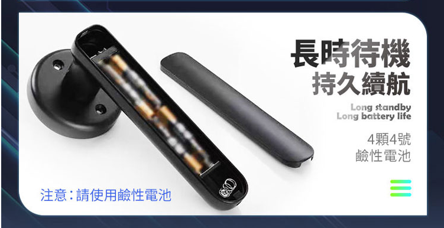

但先不說功能或是穩定性如何

把電池藏在把手這一點，就讓不才生理上沒辦法接受

電池是電池，門把是門把，怎麼可以放在一起

.

還有沒有密碼面板，如果不才手濕濕刷不過，該怎麼辦?

.

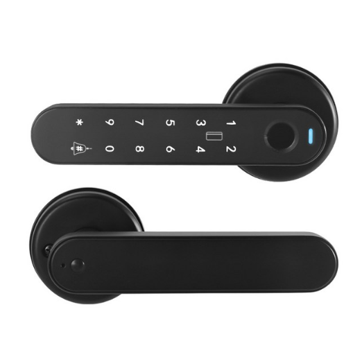

還有不少是密碼按鍵直接放在門把上的

這美感不才寧可被鎖在門外 = =

.

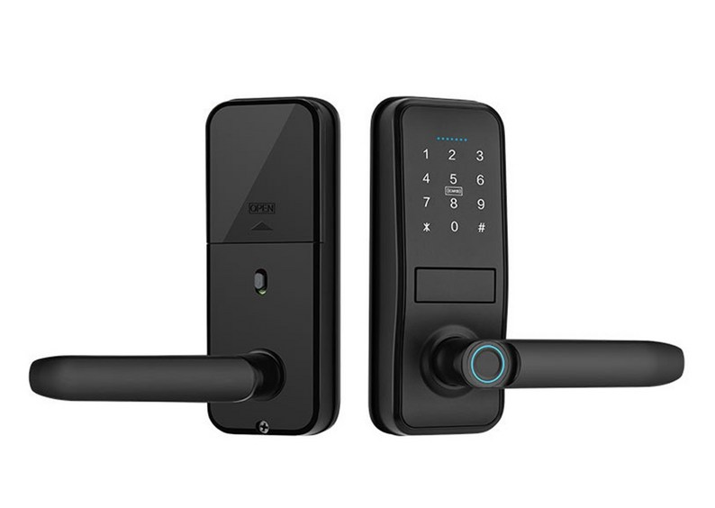

總之吧，會選這台的主要原因是:
- 有輸入密碼的區域
- 多種解鎖方式，雖然多一種方式就意味著多一種漏洞
- 電池倉不是在門把上
- 標稱感應指紋的速度 0.2 秒，算上解鎖時間應該一秒能開門
- 有賣場一台不到 1500

算是預算內相對合理的選擇

.

然後不確定未來會不會有遠端解鎖，或是查看開鎖紀錄的需求，所以選了支援遠端解鎖的版本(aka 資安漏洞 plus 版)

.

## 開箱

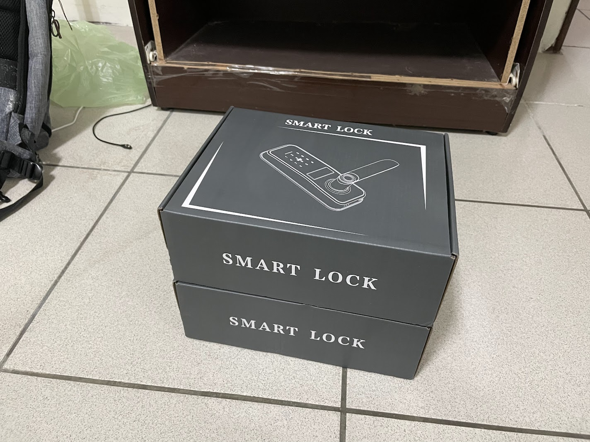

兩個房間，所以買了兩組

盒子上就寫著大大的 `SMART LOCK`

.

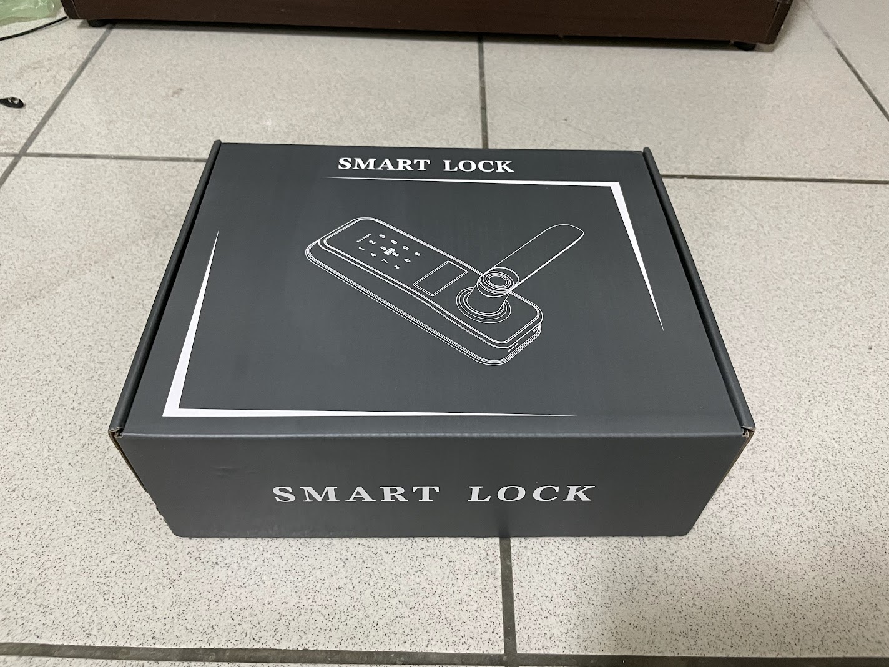

正面

.

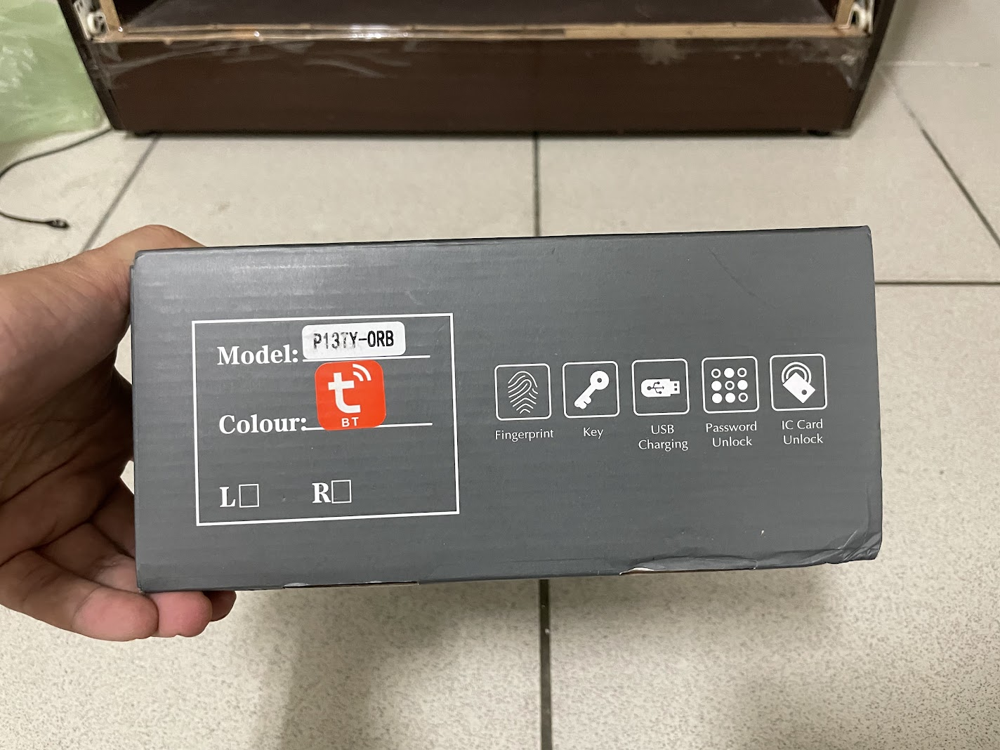

側面

不知道為什麼這邊寫的型號是 `P13TY-ORB`

旁邊有貼一張塗鴉(Tuya)藍芽的貼紙

代表可以用塗鴉 app 來設定門鎖，不用使用第三方不知道啥時會停止支援的 app

.

另外也標示了支援的解鎖方式:
- 指紋
- 鑰匙
- 密碼
- IC 卡

還有 USB 充電(電池沒電時的緊急供電，不然就只能用鑰匙開了)

.

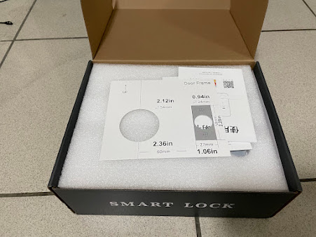

打開

最上面是開孔用的紙板和說明書，下面用泡棉墊著

.

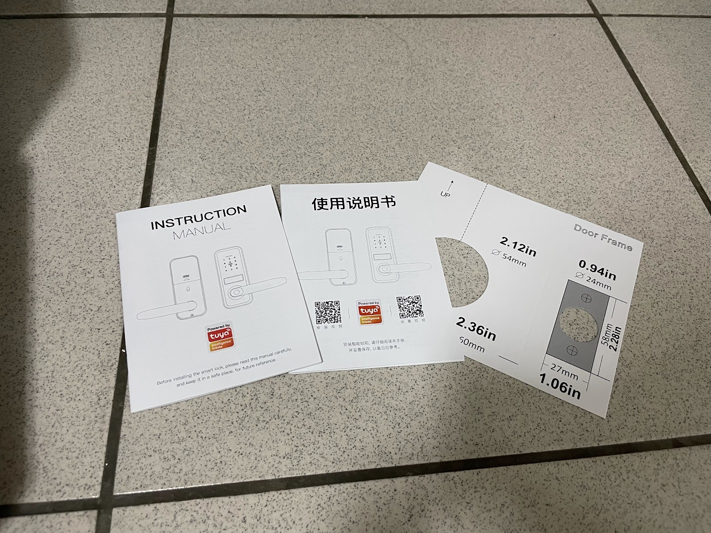

說明書有英文版和簡體中文版，還有一張門的開孔尺寸紙板

說明書上有 QR code 可以看安裝影片和設定影片

紙板上的尺寸:
- 門把的孔 `54mm`
- 門把孔到門邊的距離 `60mm`
- 門側邊的鎖舌孔 `24mm`

可以先拿來對對看家裡的門合不合(其實也不用看了，正常鎖挖的洞都是固定的)

.

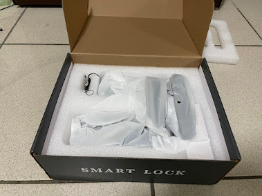

拿掉紙板後，鎖本體和配件都用白色的塑膠袋包著

.

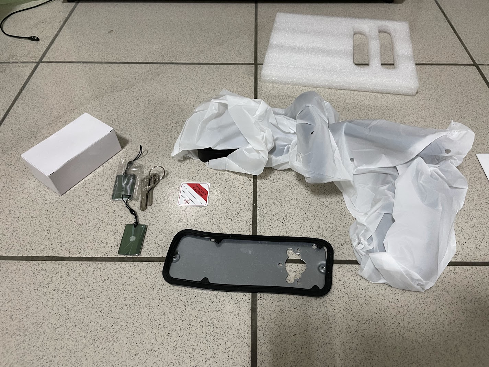

全部拿出來

有一個裝零件的小白盒、兩張 IC 卡(感應扣)、兩把鑰匙、品質卡，還有一片裝在鎖背面的背板

.

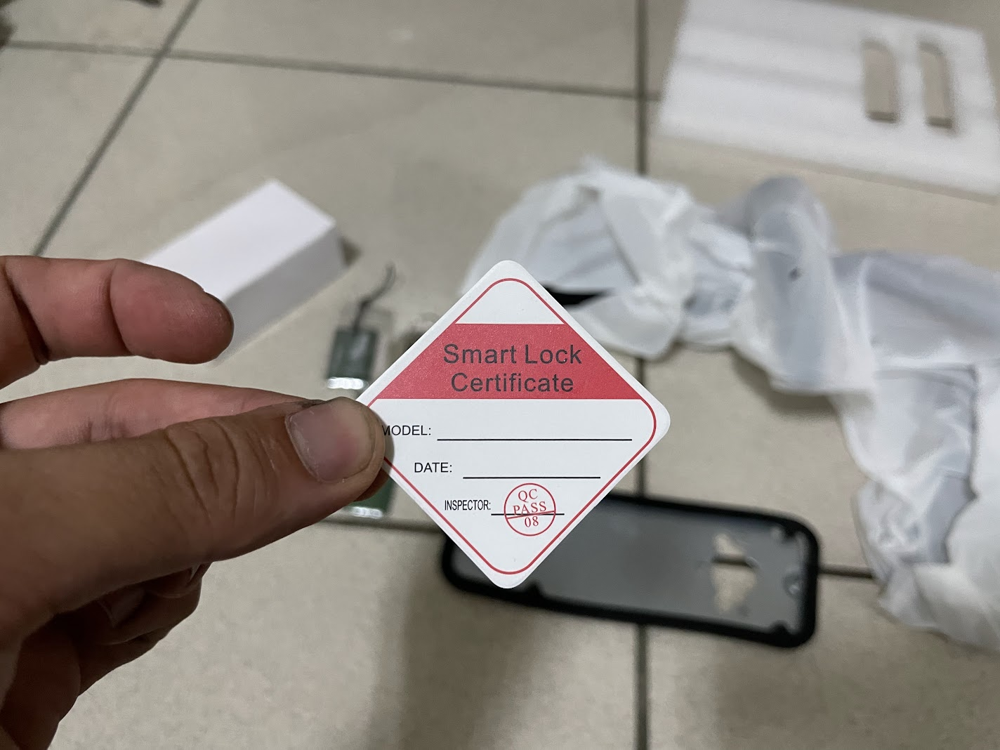

空白的品質過關卡

很迷，不知道為什麼從中國來的貨都喜歡這樣

型號、日期全部空白，只有蓋了一個 QC PASS 的章

.

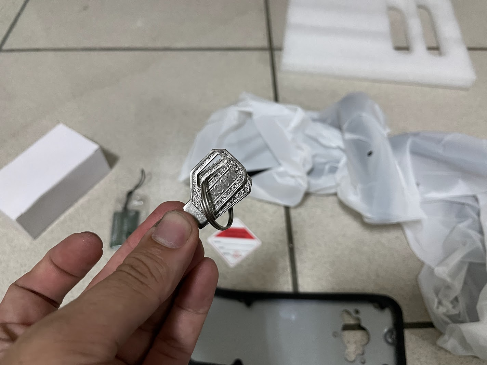

鑰匙

平常應該用不太到，但沒電或是電子的部分壞掉時就靠它了

.

看到這種東西其實挺猶豫的

理論上應該要找個地方放好，或是隨身攜帶

但隨身攜帶會嫌麻煩(不才現在只帶錢包出門，一樓共用的鑰匙放在錢包內，實在不想多帶一把)

.

不然就是找個地方藏好，但不能藏太近

例如藏在一樓門口，就是個安全破口，因為找到鑰匙的人能猜出是哪一樓的(只有不才那間是電子鎖，造型不同)，也就能進去

或許比較安全的方法是找個離家 100 公尺以上，能記住的地方把鑰匙埋了

反正鑰匙只有緊急情況才會用到

.

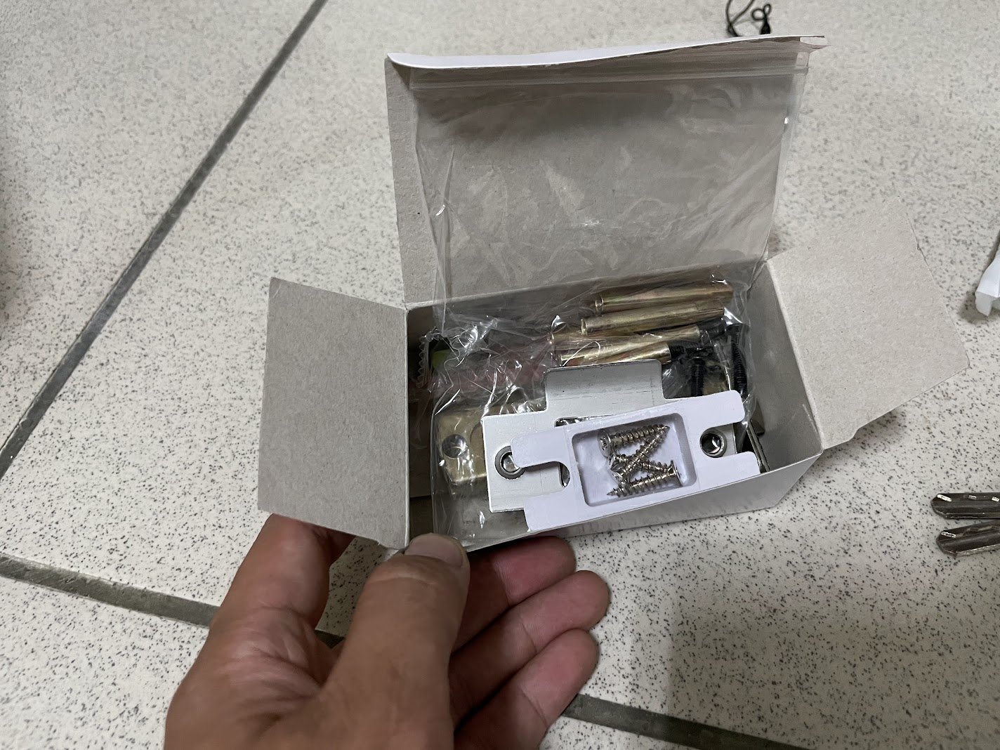

小白盒裡面是安裝用的零件

.

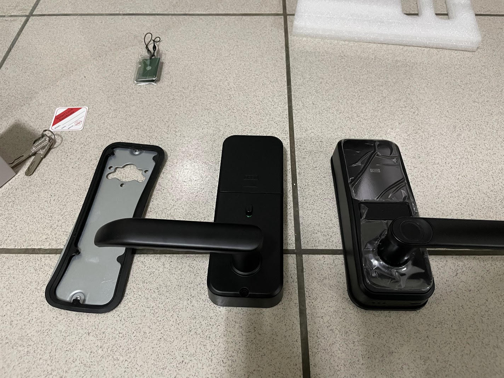

鎖本體

右邊是門外側，有數字鍵盤和指紋辨識，上面還貼著保護膜

左邊是門內側的把手，最左邊是背板

.

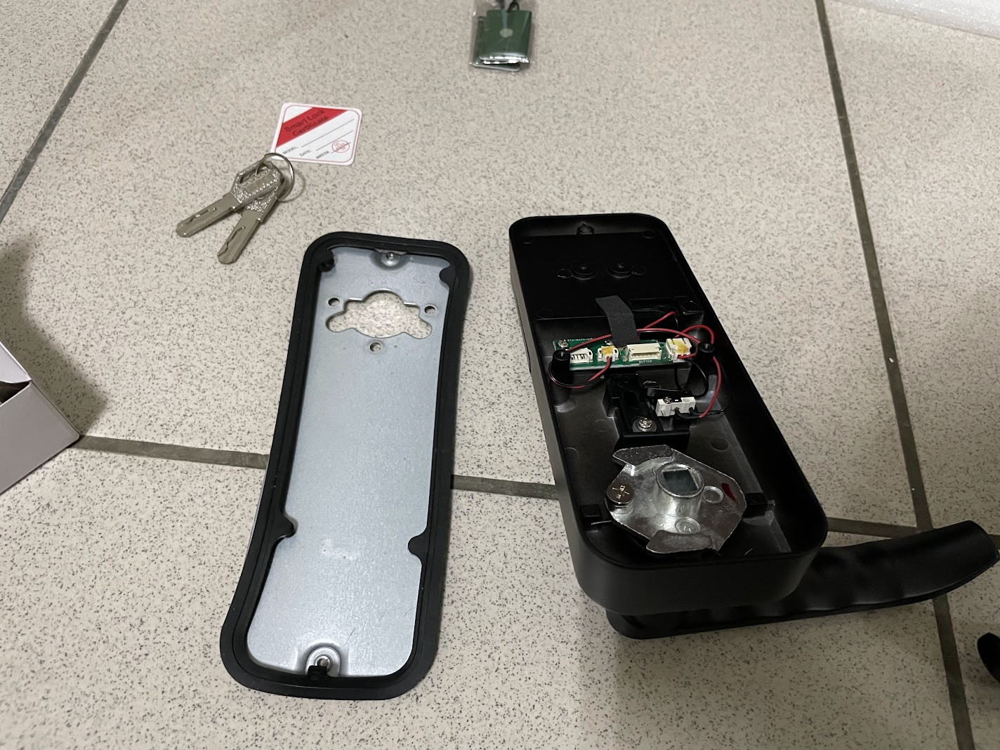

把內側打開看看

裡面有電路板，還有連接外門把手排線的孔

.

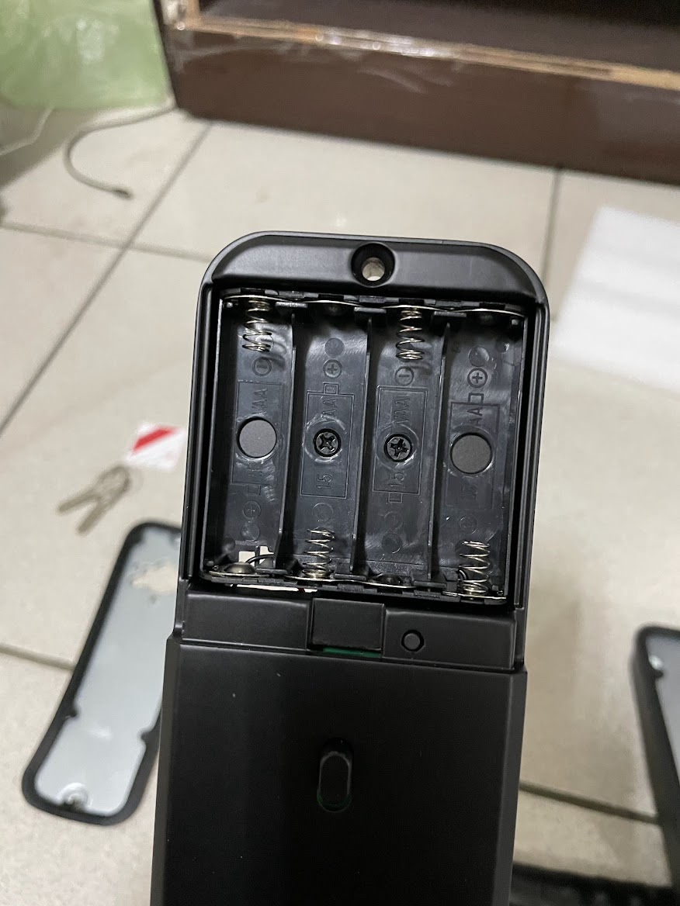

電池是 4 顆 AA 電池

這樣設計才對，電池就該有自己專屬的家

電池沒附，下重本買了 eneloop 的電池

希望電池能用到退休，一顆可不便宜

.

電子鎖只有在開鎖時才會耗電

平常只會有藍芽待機的耗電(理論上不多)

沒記錯的話正常使用應該可以用一年

另外在網路上也找不到能直接讓電子鎖插電的方案，或許也是因為續航力夠用所以沒這必要吧?

.

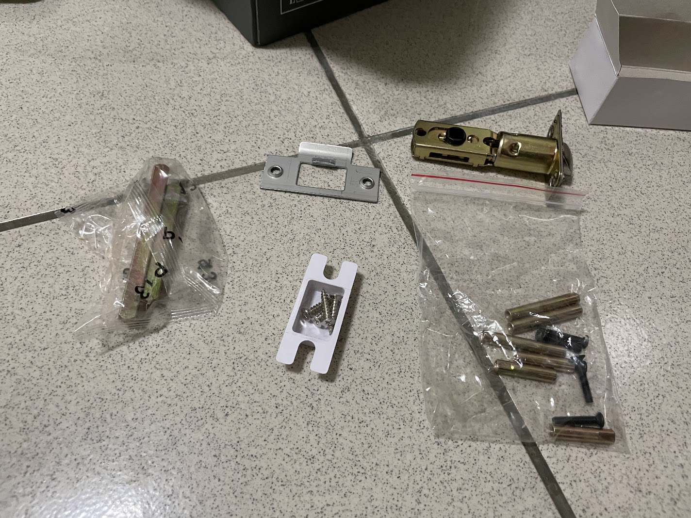

安裝用的零件:
- 鎖舌
- 門框上的扣板
- 方軸(不同門厚可以選不同長度)
- 螺絲和連接前後面板的螺絲套管

方軸和螺絲套管都有兩種尺寸

如果是房間門那種厚度，通常用短的就夠了

.

## 安裝

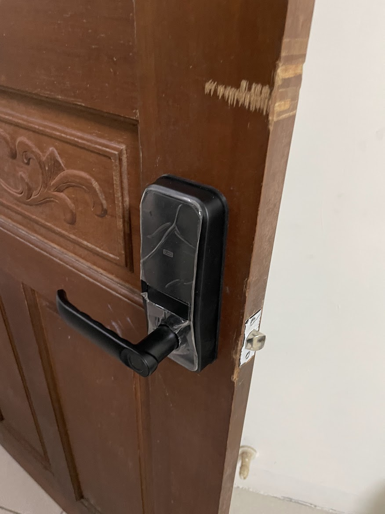

裝好的樣子

保護膜還沒撕，先測試一下能不能用

.

https://photos.app.goo.gl/xjxshLkTAKXkL6DSA

另外因為安裝時雙手都在忙，沒辦法邊裝邊拍照

這邊用縮時代替

.

基本上一個人可以安裝好，使用簡易的螺絲起子就夠了

比較大的問題會有:
1. 要知道上一個鎖到底如何拆下來
2. 上一個鎖孔側邊如果不夠大，會需要把洞挖大一點
3. 如果上一個螺絲太緊，可能會需要電鑽。如果崩牙了，會需要其他工具把螺絲拆下來

.

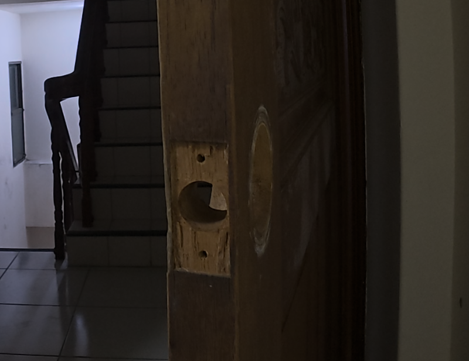

還有原本的鎖孔可能是圓的，但這個鎖需要的是有點方的孔

就需要自己挖成方形的

希望房東不要看到這篇(汗)

.

如果扣除掉拆掉上一個鎖

這個鎖安裝熟練的話 10 分鐘能搞定

.

## 設定

因為已經設定過了，這邊就直接介紹功能

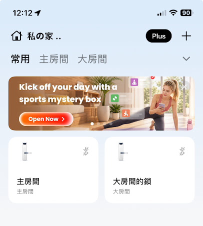

這個是塗鴉的 app ，一進首頁可以看到所有的門鎖

.

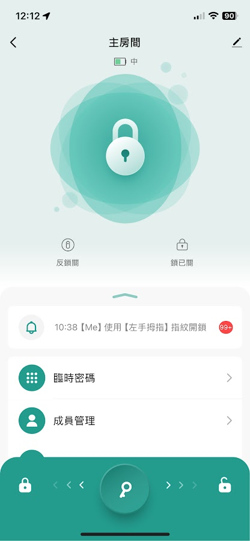

點進去後，可以看到鎖的狀態，設定，還有能夠一鍵開鎖

.

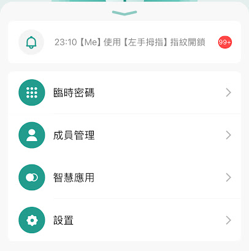

裡面比較常用的是成員管理和設定

.

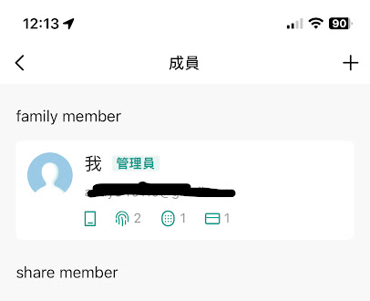

在設定指紋之前，要先設定成員

.

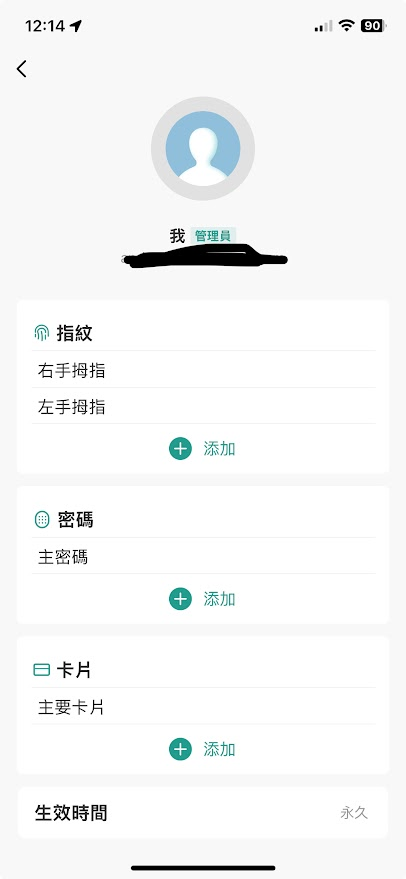

設定好成員後，就可以把指紋、密碼這些解鎖方式綁上去

.

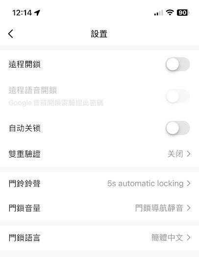

這個是設定

門預設是有語音，很吵，所以會把語音關掉

然後電池拔掉重插後語音又會出現，又要再過來關一次

但指紋紀錄還在

.

## 實際使用

https://photos.app.goo.gl/AK6AMAi5ft7VQX3T9

這個是開啟的速度

刷進去的反應速度夠快，是能夠適應的那種

.

https://photos.app.goo.gl/JMHDvwUBU53k6CDDA

這個是誤判率

如果手指頭放的位置不準，有機會判錯

如果位置沒問題，大概率可以一次刷過

如果發現經常刷不過，建議指紋重錄

.

另外手濕濕的時候就沒辦法刷了

這時候就只能靠按密碼進去

.

沒電時門鎖的下方有 USB 孔，能夠緊急臨時供電

所以保險起見(e.g. 把電池拿去充電時不小心把門關了)，不才放了一個行動電源在外面

.

如果是使用鑰匙，門把中間不是有一個看起來像是能開的框框嗎

說明書上有寫如何打開(不好開，需要點力氣)，打開後就有鑰匙孔了

怎麼開不才就不寫了，怕有人順著網線來不才家開鎖

.

## 優缺點

優點:
- 不用帶鑰匙，在兩個房間來回很方便
- 刷指紋的反應速度夠快
- 解鎖方式很多，指紋、密碼、IC 卡、鑰匙都可以
- 一個人用螺絲起子就能裝好
- 不貴

.

缺點:
- 有機率誤判，手指位置沒放好會刷不過
- 手濕濕時刷不進去，只能按密碼。如果當下把手擦乾也很容易刷不過，通常要再等一下

.

不知道算不算缺點:
- 想實現能讓朋友進自己家(遠端開鎖)，可能要買一個遙控盒子，因為這個鎖只能連上藍芽，沒辦法上網，中間需要有一個轉接器

.

## 結論

整體還是很推薦的

.

適合人群可能是想少帶一把鑰匙

經常忘記帶鑰匙

或是像不才那樣租到奇怪格局的租屋處

.

應該就這樣，如果哪天發現 bug ，或是統計出電池能撐多久，會回來回報

以上

.